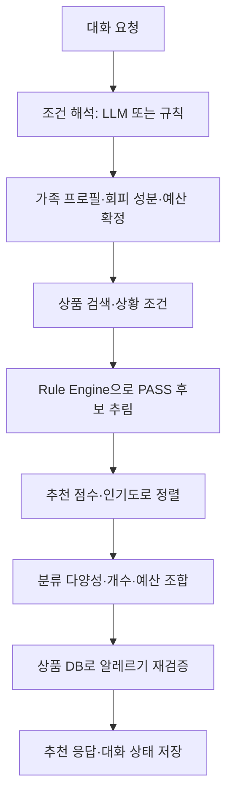

# Kurly Allergy Care 백엔드 분석·기동 시험

검증일: 2026-10-12 (한국 시간)  
대상: `jws000209/Kurly-Allergy-Care`, `feat/allergen-39`, `7c789e0` 커밋. 전체 SHA는 `audit-results.json` 참조.

## 판정

**서버와 추천 알고리즘은 기동한다. 기존 자동 테스트 45개도 통과한다. 그러나 알레르기 판정 근거에 중대한 문제가 있어 39종 전체를 신뢰할 수 있는 판정 서비스로 보기 어렵다.** 실제 API에서 사과 회피 프로필에 사과 원물이 PASS로 추천됐다. 불완전한 OCR을 확인된 원재료로 처리하는 문제도 재현했다.

이번 작업은 분석·시험·문서 갱신이다. 제품 코드는 수정하지 않았으며 발견한 결함은 남아 있다. 사용자 요청에 따라 이 보고서와 검증 자료를 저장소에 추가했다. 아래 시험 결과의 기준은 `7c789e0`이며, 후속 원재료 정제 스크립트 커밋 `08246af`는 이 시험에 포함하지 않았다.

## 1. 백엔드 구조

| 모듈 | 실제 역할 |
| --- | --- |
| `app/main.py` | FastAPI 요청 검증, 프로필·상품·판정·대화·추천 API, 시작 시 DB 초기화 |
| `app/db.py` | SQLite 계정·가족·상품·행동 이력, 시드 동기화, 기존 상품 재추출 |
| `app/allergens.py` | 기존 19종 + 확장 20종 이름·한국어 동의어·제외 표현 |
| `app/extractor.py` | 원재료·라벨을 분할하고 함유/제조시설 성분 추출, verified 계산 |
| `app/rule_engine.py` | 회피 성분과 교집합을 대조해 PASS/BLOCK/UNVERIFIED 결정 |
| `app/recommender.py` | 아이템 협업·함께 구매·TF-IDF·혼합 점수 |
| `app/cart_composer.py` | 검색 관련도, 판정 필터, 정렬, 분류 다양성, 예산·개수 조합, 재검증 |
| `app/intent.py` | LLM 구조화 출력 또는 규칙으로 요청의 사람·상품·예산·개수·동작 해석 |
| `app/profiles.py`, `situations.py` | 이름·별칭·가족 집합 해석, 소풍·캠핑 등 상황의 선호/제외 낱말 |
| `app/agent.py` | LangGraph로 대화와 장바구니 생성·수정 흐름 제어 |
| `app/selector.py` | 판정 통과한 상위 25개 후보 중 LLM이 선택, 번호·중복·예산 재검사 |

직접 `/api/recommendations`는 대화 해석과 LLM 선택을 거치지 않고 동일한 검색·추천·조합·재검증 모듈을 사용한다. 대화는 프로세스 메모리의 `MemorySaver`에 `user_id:thread_id`로 저장한다. 서버 재시작을 넘는 대화 보존은 없다.

## 2. 알고리즘 구현

### 알레르기 판정

1. 원재료명과 라벨을 문장 단위로 분할하고 알려진 오탈자를 보정한다.
2. 한국어 동의어의 부분 일치와 일부 짧은 단어의 토큰 일치를 사용한다. mask로 일부 오탐 표현을 지운다.
3. 제조시설·혼입 문구는 `cross`, 나머지는 `contains`로 분리한다.
4. 여러 가족의 회피 성분은 합집합, 엄격 모드는 한 명이라도 설정하면 적용한다.
5. `verified=False`이면 UNVERIFIED, 회피 성분 함유이면 BLOCK, 엄격 모드에서 회피 성분 혼입이면 BLOCK, 그 외 PASS다.

현재는 생성형 AI나 RAG가 알레르기를 판정하지 않는다. XLSX를 런타임에서 검색하거나 근거 ID·등급·예외 정책을 반환하는 기능도 없다. 확장 20종의 한국어 매칭어를 코드에 추가한 상태다. 재검증도 같은 추출 결과와 규칙 엔진을 사용하므로, 추출/근거 범위의 오류를 독립적으로 찾아내지는 못한다.

### 추천

| 방식 | 계산 | 대체 동작 |
| --- | --- | --- |
| 아이템 협업 `item` | 사용자×상품 행동 행렬을 상품×사용자로 전치, 상품 벡터 L2 정규화, 코사인 유사도. 경험 상품 중 양의 유사도 상위 20개로 `Σ(sim × 행동가중치) / Σ(sim) / 5` 계산 | 아이템 점수가 없으면 콘텐츠, 그것도 없으면 인기도 |
| 함께 구매 `user` | 기준 상품 또는 본인 구매 상품을 산 다른 사용자들을 모아, 후보별 구매자 수 / 해당 구매자 수 | 함께 구매 근거가 없으면 콘텐츠→인기도 |
| 콘텐츠 `content` | 상품명 2배·분류 3배·원재료 1배의 낱말 및 글자 2개 조각. `TF=1+ln(빈도)`, `IDF=1+ln((1+상품수)/(1+문서빈도))`. 행동으로 가중 합친 사용자 벡터와 코사인 비교 | 근거 없으면 인기도 |
| 혼합 `hybrid` | 아이템 0.4·함께 구매 0.3·콘텐츠 0.3. 상품별 양수 신호만 사용해 가중치 재정규화 | 신호 없으면 인기도 |

행동 가중치는 view=1, like=3, cart=4, purchase=5다. 같은 사용자·상품에서는 가장 강한 행동만 행렬에 반영한다. 함께 구매는 purchase만 사용하고 현재 사용자와 기준 상품은 집계에서 제외한다. `user`는 사용자 간 코사인 유사도가 아니다.

최종 정렬은 요청 관련도→상황 선호→옵션 여부→가상 상품 여부→추천 점수→후기 수→판매량 순위 순이다. 이후 같은 관련도에서 분류를 번갈아 선택하므로 최종 목록은 추천 점수만의 내림차순이 아니다. 예산은 최소 구매 수량을 곱한 가격으로 계산한다. `더 저렴하게`는 개인화 정렬을 건너뛰고 가격을 우선한다.

행동 행렬은 요청마다 다시 구성하고 콘텐츠 벡터는 상품 스냅샷 기준으로 캐시한다. 현재 구현은 별도 모델 학습 작업이나 학습된 임베딩 모델을 요구하지 않는다. 실구매 데이터가 없을 때는 인기·콘텐츠 대체가 주로 작동한다.

## 3. 시험 환경과 결과

- Windows, Python 3.12.14, FastAPI 0.143.0, LangGraph 1.2.14, pytest 9.1.1, httpx 0.28.1. 전체 설치 버전은 `environment.txt` 참조.
- 제품 소스와 XLSX 원본은 변경하지 않았다. 시험 계정·프로필·가상 구매는 `work/backend-audit/`의 별도 SQLite DB에만 기록했다.
- 기존 main 대신 사용자가 갱신한 `feat/allergen-39` 브랜치를 검증했다. 문서 브랜치는 병합하지 않았다.
- LLM 키를 비워 규칙 경로로 고정했다. 외부 LLM 실호출, Chrome 확장 UI, 실제 컬리 장바구니, 실구매 추천 품질은 검증 범위에 포함하지 않았다.

| 시험 | 결과 |
| --- | --- |
| 저장소 자동 테스트 | **45 passed in 2.71s** |
| 39종 표준명 각각 추출 | 39/39 성공 |
| 추가 함수 경계 시험 | 12건 중 6건 일치, 6건 불일치. 불일치는 예산 1건·확장 재료 오탐 4건·19종 근거 범위 1건 |
| Uvicorn 실제 기동 | 기본 4,062개·재료 5,327개·가상 5개 상품 시드 모두 health `ok=true` |
| 실제 TCP HTTP | health 3회 외 80회 요청. 77회 200, 잘못된 추천 프로필 3회는 기대대로 422. 의미상 오류는 아래 별도 정리 |
| 별도 ASGI 호출 | TestClient에서도 같은 시나리오와 문제 재현 |
| 추천 4개 모드 | item/user/content/hybrid 전부 응답. 시험용 다른 계정의 구매 이력이 해당 점수에 반영됨 |
| 기본 보호 동작 | 참깨 함유 BLOCK, 우유 혼입 엄격 모드 BLOCK, 근거 없음 UNVERIFIED |
| 대화 흐름 | 생성→1번 삭제→주스 추가→더 저렴하게 동작 |

최종 TCP 시험에서 기본 시드 추천 요청은 약 102~185ms, 재료 시드는 약 193~592ms였다. 로컬 단일 클라이언트의 소수 요청이며 일부 캐시가 포함된다. 부하 시험이나 운영 성능 보장은 아니다. 최종 재기동 준비 시간은 기본 약 1.87초, 재료 약 3.05초로 이미 초기화된 시험 DB를 사용했다.

대화의 실제 합계 변화:

| 시드 | 생성: 주스 2개 | 1번 삭제 | 주스 1개 추가 | 더 저렴하게 |
| --- | ---: | ---: | ---: | ---: |
| 기본 | 11,960원 | 4,980원 | 11,960원 | 8,070원 |
| 재료 | 18,960원 | 11,980원 | 18,960원 | 11,960원 |

초기 시험의 임시 디렉터리 경로 오류는 경로 수정 후 해소했다. 초기 HTTP 연결은 서버가 준비되기 전에 시도해 시간 초과됐으며, readiness 로그를 기다리도록 시험 절차를 보완한 뒤 실제 HTTP 검증을 완료했다. 이 두 항목은 제품 결함으로 집계하지 않았다.

## 4. 재현한 문제와 피드백

### P1 — 기존 19종 검토 근거로 확장 성분까지 PASS

**재현:** 사과 회피 프로필로 `keywords=["사과"]` 추천. 기본 시드에서 `5005943` 저탄소 사과 등 사과 원물 5개가 PASS로 반환됐다.

기본 시드 4,062개 중 원재료명이 있는 상품은 0개이고, 1,010개에는 ‘원물·단순 구성으로 19종 없음 판단’ 표시가 있다. `extractor.py:78`은 이를 성분 목록이 빈 검증 완료 상품으로 만들고 `rule_engine.py:27` 이후는 이 근거의 19종 범위를 구분하지 않는다.

**개선:** 상품 단위 verified를 성분별 검증 범위·출처로 확장하고, 기존 19종 검토를 확장 20종에 전용하지 않아야 한다. 확장 성분의 충분한 근거가 없으면 UNVERIFIED로 처리한다. 원물도 검토된 성분 근거를 갖춰야 한다.

### P1 — OCR 일부 문자열이 충분한 판정 근거가 됨

**재현:** 재료 시드 `5141905` `[자임] 당근사과 착즙주스 1L`이 사과 회피 추천에서 PASS다. 해당 ingredients는 `비타민C 직사광선을 피해 서늘한 곳에서 실온 보관하십시오.`이고 라벨은 제조시설 문구뿐이다. `1001558590` 문경사과 롤케이크도 잘린 원재료 OCR을 가지고 사과 회피 시 PASS로 반환됐다.

`build_material_seed.py:43`은 `allergy_info`가 빈 값이 아니면 OCR을 ingredients에 넣는다. 제조시설 문구만 있어도 조건을 만족한다. `extractor.py:103`은 ingredients에 어떤 문자열이든 있으면 verified로 처리한다. 따라서 ‘정보가 있다’와 ‘전체 성분을 확인할 근거가 있다’를 구분하지 못한다.

**개선:** OCR 원문과 확인된 원재료를 분리하고 출처·완전성·검토 상태를 보존한다. 제조시설 표시의 존재로 원재료를 검증 완료로 승격하지 않아야 한다. 상품명과 추출 근거의 불일치는 검토 대상으로 남기되 상품명 하나로 전체 판정을 대신하지 않는다. 새 시드 선택만으로 앞의 문제가 해소되지는 않는다.

### P1 — 잘못된 프로필이 회피 조건 없이 판정됨

**재현:** `/api/check`에 유효한 사용자와 `member_ids=[999999]`, `ingredients="우유"`를 전송하면 HTTP 200 / PASS / `avoid=[]`, `contains=["우유"]`다. 세 시드에서 동일하게 재현됐다. `/api/recommendations`는 같은 프로필 오류에 422를 반환한다.

`main.py:154`가 존재하지 않거나 다른 사용자의 프로필을 조용히 필터링하기 때문이다.

**개선:** 판정·추천·대화 API에 공통 사용자/프로필 검증을 적용한다. 요청한 프로필이 누락됐을 때 빈 회피 조건으로 계속 처리하지 않아야 한다.

### P2 — 가능한 예산 조합을 놓침

**재현:** 같은 분류 후보의 가격이 `[1000,3000,5000,10000]`이고 ‘2개, 8천원 안팎’이면 허용 합계는 6,800~9,200원이다. 3,000+5,000원 조합이 있지만 빈 목록과 ‘조건에 맞는 상품 없음’을 반환한다. 함수와 실제 `/api/chat` 모두 재현됐다.

`cart_composer.py:317`은 남은 후보의 최소·최대 합이 범위와 겹치는지만 확인한다. 첫 1,000원 후보를 고른 뒤 가능한 나머지를 찾지 못하면 앞 선택을 되돌리지 않는다. 최소·최대 사이에 실제 조합이 존재한다는 보장이 없다.

**개선:** 하한이 있는 안팎·범위 예산에는 가능한 합을 확인하는 DP 또는 가지치기와 되돌아가기가 필요하다. 해당 입력을 회귀 테스트로 추가한다.

### P2 — 확장 재료가 기존 성분으로도 오탐

**재현:** 단일 원재료 `캐슈밀크`/`캐슈버터`는 우유+캐슈넛, `루핀콩`은 대두+루핀, `바나나밀`은 밀+바나나로 추출된다. 이 시험은 순수 식물성 원재료 문자열에 다른 성분 정보가 없는 입력이다. 실제 혼합 제품의 성분 부재를 단정하는 시험이 아니다.

기존 밀크·버터·콩·밀의 부분 일치와 확장 사전의 파생어가 충돌한다.

**개선:** XLSX의 예외·검토 규칙과 정규화 정책을 추출기에 반영하고, 순수 파생 원료와 실제 혼합 성분을 구분해야 한다. 이런 오탐은 피할 필요가 없는 상품을 배제해 추천 후보를 줄인다.

### P2 — 규칙 파서에서 묶음별 개수 누락

**재현:** ‘주스 3개랑 콜라 1개 1만원 이내’를 주스 2개+콜라 1개, 총 3개로 반환한다. 의도 JSON의 전체 item_count가 3이고 각 group.count는 null이다.

`intent.py`의 `rule_parse`는 최초 개수를 전체 개수로 읽고, 묶음별 개수는 `N개씩`에 한해서 채운다.

**개선:** 각 상품 구절의 개수를 독립적으로 파싱하고 전체 합계와 일치시킨다. 외부 LLM이 실패해 규칙 파서로 전환됐을 때도 같은 문제가 생길 수 있다. 이번 시험은 LLM을 실제 호출하지 않았다.

## 5. 추천 품질과 설계 피드백

- **아이템 점수의 동률:** 단일 기준 상품의 행동 가중치가 5이면 양의 유사도가 있는 후보의 점수는 유사도 크기와 관계없이 1.0이다. 모든 경험 상품의 행동이 purchase=5인 경우에도 동일하다. 기존 예시와 테스트가 의도한 수식이라 구현 오류로 집계하지 않았지만, 상품 간 순위를 구분하는 능력은 약하다. 실구매 ranking 평가 후 유사도 합·공통 구매자 수 보정 등 대안을 비교해야 한다.
- **혼합 점수의 비교 기준:** 상품마다 양수 신호만 재정규화하므로 한 종류의 근거만 강한 상품과 여러 종류의 근거가 있는 상품의 점수를 같은 척도로 해석하기 어렵다. 제공된 동작은 확인했지만 품질 우수성을 입증한 것은 아니다.
- **원재료 데이터의 영향:** 기본 시드는 원재료명이 전부 비어 있어 콘텐츠 추천이 이름·분류에 의존한다. 새 시드는 원재료 4,684개가 있지만 OCR 잡음도 TF-IDF에 들어간다. 원재료 정제와 판정 근거 검토를 함께 진행해야 한다.
- **인기·다양성:** 후기 수는 인기의 대리값이며 실제 구매 선호와 같지 않다. 분류 순환 선택은 개인화 점수의 엄격한 순위를 바꾼다. 목표가 다양성인지 구매 적합도인지 정하고 평가해야 한다.
- **성능·운영:** 요청마다 전체 상품·행동을 읽고 행렬을 재구성한다. 지금의 소규모 HTTP 시험은 통과했지만 이력 증가 시 캐시·집계·인덱스·부하 시험이 필요하다. 계정은 이름 기반이고 대화는 메모리에 있으므로 운영 인증·영속화도 별도 과제다.

권장 수정 순서는 **판정 근거 범위와 OCR 검증 → 프로필 검증 → 예산 조합·수량 해석 → 오탐 정리 → 실구매 추천 품질 평가**다. 우선 세 P1 항목을 수정한 뒤, 실상품과 알려진 성분 정답을 이용해 미검출과 오탐을 따로 평가해야 한다.

## 6. 재현 자료

- `audit-results.json`: 최종 실제 TCP HTTP 결과, 함수 시험과 시드 분석.
- `audit-asgi-results.json`: 별도 ASGI 경로 시험 결과.
- `reproduce_audit.py`: 저장소 안에서 실행하는 시험 스크립트. 실행 위치의 `backend-audit-results/`에 결과와 실행별 시험 DB·로그를 쓰며 실사용 DB는 사용하지 않는다.
- `pytest.log`, `pytest-results.xml`: 저장소 자동 테스트 결과.
- `uvicorn-default.log`, `uvicorn-material.log`, `uvicorn-synthetic.log`: 최종 실제 서버 로그.
- `environment.txt`: Python 및 설치 의존성 버전.

프로젝트 루트에서 `backend/.venv/Scripts/python.exe docs/backend-audit/reproduce_audit.py`로 실제 HTTP 시나리오를 재현한다. 다른 운영체제에서는 해당 가상환경 Python 경로를 사용한다. `--asgi`를 붙이면 TestClient 시험이다. 기존 자동 테스트는 backend에서 `.venv/Scripts/python.exe -m pytest -q`로 실행한다. Windows 임시 경로 제한이 있는 환경에서는 TEMP/TMP를 작업 공간의 기존 폴더로 지정해야 한다.

시험 서버는 모두 종료했다. README와 Handoff에 검증 결과와 미수정 결함을 기록했다.
